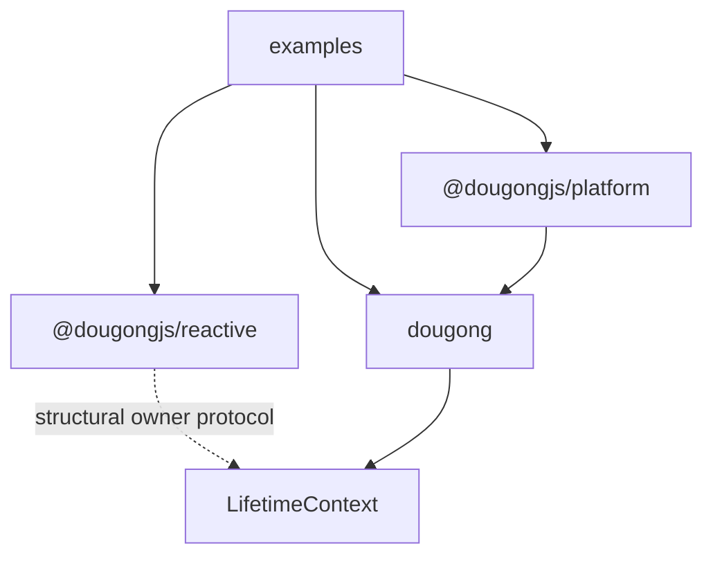
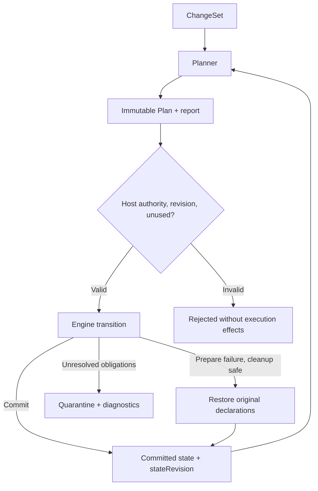

# Architecture diagrams

These diagrams describe the current responsibility boundaries. Source links are repository-relative so a revision cannot silently claim evidence from another commit.

## Package dependencies

The dashed relationship is protocol compatibility, not a package dependency. Reactive imports no other package. Platform consumes only `dougong` and its formal `dougong/advanced` subpath.

Sources: [package directions](../tooling/architecture/check-layers.mjs), [Core entry](../packages/dougong/src/index.ts), [Platform entry](../packages/platform/src/index.ts), [reactive protocol](../packages/reactive/src/protocol.ts).

## Plan and execution authority

Services, listeners, contributions and origin become visible in the same publication boundary. Resource obligations remain owned after failed shutdown. External network or filesystem effects are outside the atomic-publication guarantee.

Sources: [Planner](../packages/dougong/src/composition/planner.ts), [Plan authority](../packages/dougong/src/composition/plan.ts), [Engine](../packages/dougong/src/execution/engine.ts), [Lifetime](../packages/dougong/src/lifetime/lifetime.ts).
